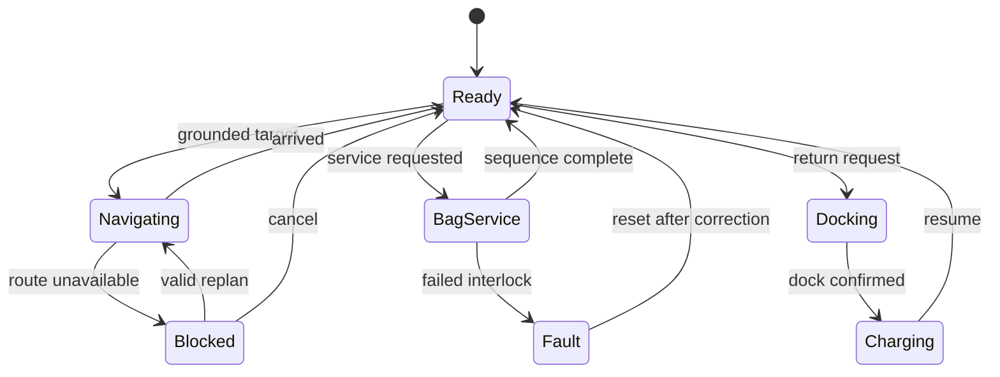

# Synopsis — Trash Gordon

**Ishdeep Singh · 12 November 2026**

## V2 interface release

A 3D robot inspection studio.

- Large orbitable robot model and an apartment camera
- Furniture geometry follows the authored navigation occupancy map
- Speaker marker, grounded commands, routing and pause/stop controls
- Selectable lid, bag and drive with explicit mechanism transitions

CPU-rendered 3D works without WebGL. All mechanical actions remain simulations. The underlying domain scope and research-extension boundaries below remain explicit.

## Implemented release

Runnable source: `lab/robot.py`. Interface and backend are included. Tests and benchmark outputs accompany this distribution.

## Limits of the implemented release

Known-map A* navigation and simulated lid/bag/docking logic. No SLAM, physical mechanism validation or telepathic speaker localization.

## Measured evaluation

```json
{
  "navigation_tasks": 20,
  "successes": 20,
  "collisions": 0,
  "bag_motion_interlock": true,
  "note": "Twenty seeded goal checks in the authored room; physical sensors, SLAM, sealing and inflation are not validated."
}
```

## Original specification and proposed extensions

The material below preserves the design ambitions. Future-tense features and anticipated challenges are not completed-development claims.

Trash Gordon

**Tagline:** “Dustbin, come here.” A simple sentence with an absolutely unreasonable amount of engineering behind it.

### Concept, problem, and users

Trash Gordon is a simulated mobile smart dustbin with grounded voice commands, indoor navigation, an automatic lid, a status display, bag-operation sequences, and docking. It extends a basic animated bin into a coordinated robot system.

The first audience is project evaluators, robotics learners, and people developing assistive household concepts. The research question is whether explicit command grounding and recovery logic improve task completion on unseen room arrangements and paraphrased commands.

### Proposed product and workflow

1. Load a furnished apartment and select or track a user position.
2. Say or type a command; show the transcript and interpreted destination.
3. Confirm ambiguity through a short choice when necessary.
4. Plan a route around furniture and dynamic obstacles.
5. Stop near the target, expose lid controls, and update fill status.
6. Trigger simulated bag sealing, removal confirmation, and new-bag inflation.
7. Return to the dock when requested or when the battery policy requires it.

Screens: 3D room, room editor, command history, robot status, mechanism controls, sensor overlays, and mission replay. The robot model should show wheels, lid hinge, display, bag cartridge, docking contacts, and visible mechanism states. Animation should follow simulation events; an animation finishing must not silently imply a real sensor succeeded.

### Data and system design

Entities include `RobotPose`, `OccupancyGrid`, `Landmark`, `SpeakerTarget`, `CommandIntent`, `Mission`, `ObstacleTrack`, `MechanismState`, and `TelemetrySample`. Store coordinate frames and units. A spoken “here” requires a tracked speaker position, a selected marker, or another explicit location source.

Generate permitted simulated room layouts, navigation tasks, noisy observations, and command paraphrases. Split by layout and paraphrase family; include blocked destinations and ambiguous instructions. The click-to-summon version needs no microphone. Typed commands remain a fallback when speech recognition is unavailable.

### Algorithms and experiments

Baseline: click-selected targets with an occupancy grid, A* routing, and a conservative collision controller. Add intent extraction and landmark grounding, then dynamic obstacle handling and route recovery. Known-map navigation comes before a claimed mapping or SLAM capability. A future physical branch can evaluate ROS 2/Nav2 concepts [R3]; the browser simulator does not automatically become a ROS robot.

Use explicit mechanism states and interlocks. Motion pauses during bag servicing. Closing the lid requires a clear opening signal in the simulated sensor model. A blocked route should produce a wait, replan, or unable-to-reach outcome. The display reports battery, fill, mission, warnings, and bag availability.



This is a high-level mission diagram; lid and bag actuators need their own subordinate states. An emergency stop can interrupt every motion-capable state.

Evaluate command-intent accuracy, correct destination grounding, task success, collision count, completion time, docking success, and prohibited state transitions. Ablate grounding confirmation and recovery. The collision target is zero in the defined test suite; no measured collision result exists yet.

### Anticipated problems, in my voice

| What could go wrong | My likely reaction | Engineering response |
|---|---|---|
| The bin understands “here” but has no location | “Speech recognition unlocked. Telepathy still unavailable.” | Require a location source and show the resolved marker |
| It drives while servicing the bag | “The dustbin has chosen multitasking at the worst possible time.” | Mechanism interlocks and mission-state validation |
| A beautiful animation hides a failed mission | “Cinematic trailer: excellent. Robotics: still pending.” | Drive animation from authoritative state and logged outcomes |

### Demo, milestones, and limits

Summon the robot near a sofa, move an obstacle into its route, show recovery, open the lid, simulate fill, complete bag service, and dock. Build order: reliable room and robot; click navigation; lid/display; bag states; command grounding; dynamic recovery; unseen-layout evaluation. Sealing, new-bag inflation, heater control, and physical docking hardware are separate mechanical/electrical work. The first release demonstrates their state logic and animation, not proven physical reliability.


## Problems actually encountered during the makeover

| The problem | In my voice | What changed |
|---|---|---|
| Sample B overwrote the file used by sample A | “Bro, this is an A/B test, why did B steal A’s identity?” | Recordings now get unique file names; a regression test checks both files remain distinct and unchanged. |
| A duplicate highlight followed row positions instead of duplicate evidence | “Apparently every third row had been arrested on vibes.” | Duplicate highlights now use exact record content and jump to a real duplicate. |
| The table displayed a rounded number that search did not match | “I copied the number from your own screen, my guy.” | Search checks both raw values and the formatted values visible in the table. |
| Graph labels became tiny on a phone | “Causal inference, now available to ants.” | Graph workspaces keep readable node widths and scroll within their own viewport. |
| Robot movement and the play button disagreed about whether it was running | “Gordon left the parking spot while the button was still contemplating life.” | The live flag is synchronized after accepted commands and remains off after rejected commands. |
| Fast screenshots caught an interface between renders | “The UI took a smoke break precisely when the camera arrived.” | Captures were inspected, incomplete frames replaced, and videos labelled as edited screenshots. |

These are observed build issues. Proposed research challenges in the original specifications remain proposed; this log does not invent months of model training or real deployments.
